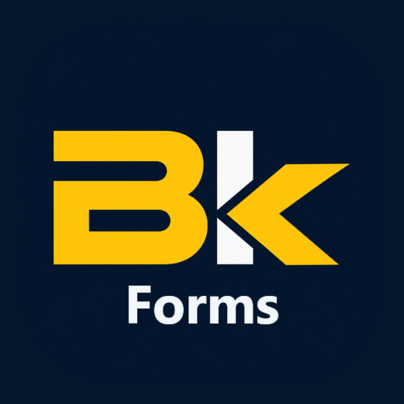
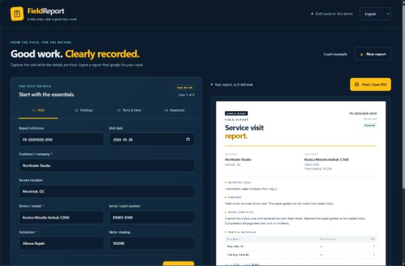

<p align="center"></p>

# Field Report

**Good work. Clearly recorded.**

A lightweight service-report builder for field technicians, created by
**Alireza Rajabi**. Turn the details of a visit into a clear, print-ready report
without an account, a backend or a subscription.

**[Open the live app](https://alirezarajabi-dev.github.io/field-report/)** ·
[فارسی](https://alirezarajabi-dev.github.io/field-report/?lang=fa)



## From a service visit to a useful record

1. **Visit** — customer, location, exact device, serial, technician and meter.
2. **Findings** — reported issue, diagnosis, work completed and verification.
3. **Parts & time** — materials used, references, quantities and time on site.
4. **Handover** — outcome, next steps and completion checks.

The report updates while typing. English and Farsi include appropriate LTR/RTL
layout, a fully localized example, and a Persian (Solar Hijri) date picker in Farsi.
A separate preview is available on smaller screens. Required-field validation
helps keep incomplete reports out of the print flow.

## Small by design

| Area | Implementation |
| --- | --- |
| Interface | Semantic HTML and responsive CSS |
| Application | Browser-native JavaScript ES modules |
| Drafts | localStorage, plus portable JSON export/import |
| Output | Browser printing with a dedicated A4 print stylesheet |
| Typography | System UI / Segoe UI, Vazirmatn and a small Caveat accent |
| Dependencies | No JavaScript packages, remote APIs, analytics or build step |

The navy, gold and teal palette follows the visual language of my Bizkonic
project. Field Report is a separate application.

## Add to your home screen

The dedicated **BK Forms** icon includes both BK and Forms inside the image.
The installed app is named **Field Report**. On iPhone, use Safari → Share →
Add to Home Screen. An older shortcut may keep its cached icon; remove that
shortcut and add it again from the live app. Save any important draft as a JSON
file before removing a standalone installation. Browser installation support varies;
there is no offline cache or cloud sync.

The [assets folder](assets/) includes the approved SVG and PNG exports for Apple
(180px), regular icons (192px and 512px), and maskable installation (512px).
These assets are separate from the main Bizkonic and Command Desk logos.

## Run locally

Requires **Node.js 20+**. No installation step is needed.

```sh
git clone https://github.com/alirezarajabi-dev/field-report.git
cd field-report
node server.mjs
```

Open **http://127.0.0.1:8862/**. The local server also provides scaled device
previews at `/review/desktop`, `/review/tablet` and `/review/mobile`.

Run the tests:

```sh
npm test
```

Tests cover draft round trips, import validation, Persian/Arabic digits, Nowruz,
leap-year Esfand, calendar navigation, date round trips, preservation of edited notes,
part quantities and escaping user-entered text. They use Node's built-in test
runner; no test packages are required.

## Drafts and privacy

- The initial example is fictional and visibly labelled **Sample report**.
- A single current draft stays in this browser's localStorage. There is no cloud
  sync or encrypted account storage. Clearing browser data may remove the draft.
- Use **Save draft file** to keep a portable JSON copy; **Open draft file**
  restores it. A new report asks before replacing the current draft.
- The application does not send report contents to a server.

## Print or save a PDF

Select **Print / Save PDF**, then choose your printer or **Save as PDF** in the
browser's print dialog. The editor is excluded from the printed report; the
report stays open in the same page. Native printing and PDF options depend on
the browser/device. Physical iPhone PDF saving has not been verified.

## Deploy

This repository is served directly by **GitHub Pages** from `main` / root.
`.nojekyll` keeps it a plain static site. All browser scripts, styles and fonts
use relative paths so project-page hosting works without a build step.

## Fonts

Font files are included locally, together with their Open Font License texts
in `fonts/`. No external font request is needed.

---

Created by **Alireza Rajabi** · [alirezarajabi.com](https://alirezarajabi.com/)